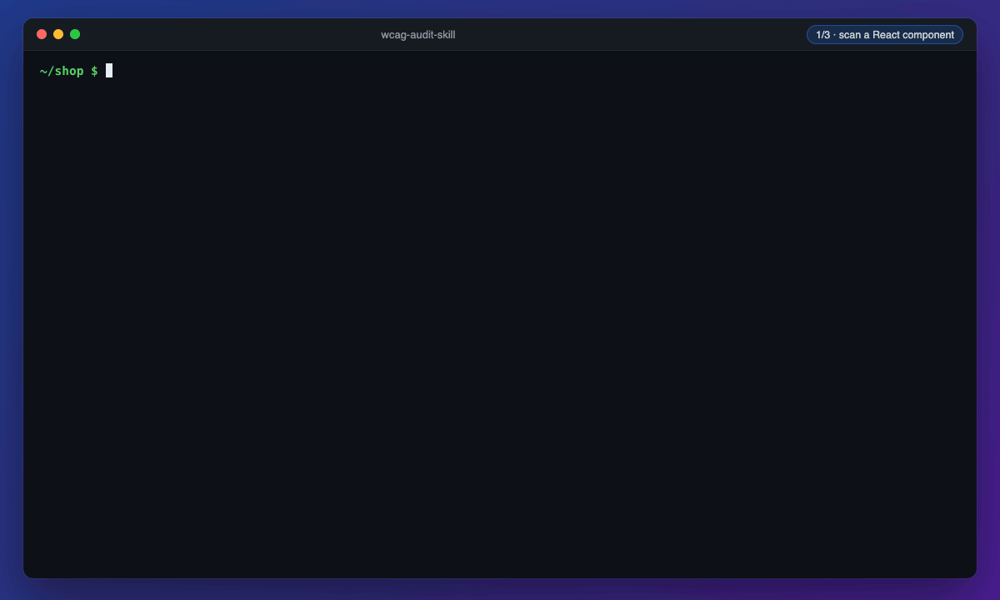

<div align="center">

# wcag-audit-skill

**AI ships inaccessible UIs. This makes your agent fix them.**

An [Agent Skill](https://agentskills.io) + CLI that audits your UI against **WCAG 2.2** in phases:
static source scan → real-browser scan → verification → fix → report.
Verified, machine-readable findings. SARIF for GitHub code scanning.

Works with **Claude Code**, **Codex**, **Cursor** and any agent that reads `SKILL.md` or `AGENTS.md`.

[](https://github.com/mintwork/wcag-audit-skill/actions/workflows/ci.yml) [](https://www.npmjs.com/package/@mintwork/wcag-audit-skill) [](https://www.npmjs.com/package/@mintwork/wcag-audit-skill#provenance) [](package.json) [](LICENSE) [](https://www.w3.org/TR/WCAG22/) [](https://github.com/mintwork/wcag-audit-skill/stargazers)



</div>

---

Ask an agent for a checkout form and you get this:

```tsx
<form>
  <h1>Checkout</h1>
  <h3>Card details</h3>
  <input type="text" placeholder="Card number" />
  <button onClick={close}><XIcon /></button>
  <div className="pay" onClick={onPay}>Pay now</div>
  
</form>
```

It looks fine. A blind user hears *"edit text, button, image"*. A keyboard user can't reach **Pay now** at all.
Roughly **95% of the top million home pages have detectable WCAG failures** ([WebAIM Million](https://webaim.org/projects/million/)) — and models learned from them.

Install the skill and say **"audit this for accessibility and fix it"**:

```text
$ npx @mintwork/wcag-audit-skill scan src/Checkout.tsx      # output abridged

  CRITICAL form-label      WCAG 1.3.1, 3.3.2, 4.1.2 (A)   src/Checkout.tsx:6:7
           Control relies on placeholder text, which disappears on input and is not a reliable label.
  CRITICAL button-name     WCAG 4.1.2 (A)                  src/Checkout.tsx:7:7
           Button has no accessible name; screen readers announce only "button".
  CRITICAL no-div-button   WCAG 2.1.1, 4.1.2 (A)           src/Checkout.tsx:8:7
           <div> has a click handler but no role, is not focusable, and no keyboard support.
  CRITICAL img-alt         WCAG 1.1.1 (A)                  src/Checkout.tsx:9:7
           Image has no alt attribute, so screen readers announce the file name or nothing at all.
  MODERATE heading-order   WCAG 1.3.1 (A)                  src/Checkout.tsx:5:7
           Heading level jumps from h1 to h3.
```

The agent verifies each finding against the source, then applies minimal, explained fixes:

```tsx
<form>
  <h1>Checkout</h1>
  <h2>Card details</h2>                                         {/* outline fixed, same styling */}
  <label htmlFor="card">Card number</label>
  <input id="card" type="text" autoComplete="cc-number" />
  <button type="button" aria-label="Close" onClick={close}><XIcon aria-hidden="true" /></button>
  <button type="button" className="pay" onClick={onPay}>Pay now</button>
    {/* asked you first */}
</form>
```

…and proves it with `wcag-audit-skill verify` (resolved / remaining / introduced), then writes a report.

## Install

| Agent | One line |
| --- | --- |
| **Claude Code** | `/plugin marketplace add mintwork/wcag-audit-skill` then `/plugin install wcag-audit@wcag-audit-skill` |
| **Any skills-compatible agent** | `npx skills add https://github.com/mintwork/wcag-audit-skill --skill wcag-audit` |
| **Codex / AGENTS.md agents** | paste [`integrations/codex/AGENTS.md`](integrations/codex/AGENTS.md) into your `AGENTS.md` |
| **Cursor** | copy [`integrations/cursor/wcag-audit.mdc`](integrations/cursor/wcag-audit.mdc) to `.cursor/rules/` |
| **CLI only** | `npx @mintwork/wcag-audit-skill scan ./src` |
| **CI** | [GitHub Action](#github-action) → findings in code scanning |

Manual Claude Code install: `cp -r skills/wcag-audit ~/.claude/skills/` (more in [integrations/claude-code](integrations/claude-code/README.md)).

## How it works

The skill ([`skills/wcag-audit/SKILL.md`](skills/wcag-audit/SKILL.md)) gives the agent a phased procedure, modeled on adversarial security audits:

| Phase | What happens | Output |
| --- | --- | --- |
| **1. Static scan** | CLI parses HTML, JSX/TSX, Vue, Svelte, Astro and checks 24 rules. The agent then reviews what tools miss: shared components, `outline: none`, color-only state. | `.wcag-audit/static.json` |
| **2. Runtime scan** | Starts your dev server, opens pages in real Chromium, runs **axe-core**, and **tabs through the page** to catch keyboard traps and invisible focus. | `.wcag-audit/runtime.json` |
| **3. Verification** | Each candidate is re-checked to *disprove* it: trace props and spreads, check the rendered DOM. Verdict: `confirmed`, `needs_validation`, or `rejected`. Runtime violations are re-run automatically and dropped if they don't reproduce. | verdicts |
| **4. Fix** | Minimal, native-HTML-first fixes in your framework's idiom, each explained (what was wrong, who it affected, what changed). Visual/copy changes need your OK. Never invents alt text. | diffs + `verify` |
| **5. Report** | Schema-validated `findings.json` + `REPORT.md`: fixed, needs your input, rejected, and what automation can't test. | `.wcag-audit/REPORT.md` |

## CLI

```bash
npx @mintwork/wcag-audit-skill scan ./src                        # static: HTML / JSX / TSX / Vue / Svelte / Astro / CSS
npx @mintwork/wcag-audit-skill scan http://localhost:3000        # runtime: axe-core + keyboard checks in Chromium
npx @mintwork/wcag-audit-skill scan ./dist/index.html --runtime  # open a local file in the browser
npx @mintwork/wcag-audit-skill scan ./src --json -o a11y.json    # machine-readable
npx @mintwork/wcag-audit-skill scan ./src --sarif -o a11y.sarif  # GitHub code scanning
npx @mintwork/wcag-audit-skill verify a11y.json                  # after fixing: resolved / remaining / introduced
npx @mintwork/wcag-audit-skill rules                             # list rules + WCAG mapping
```

| Option | |
| --- | --- |
| `--fail-on <sev>` | exit 1 at `critical`/`serious`/`moderate`/`minor` (default `minor`) or `none` |
| `--min-confidence <c>` | drop findings below `high`/`medium` |
| `--rules a,b` / `--ignore dir,dir` | select rules / skip directories |
| `--level A\|AA\|AAA` | runtime WCAG level (default `AA`) |
| `--best-practice` | add axe best-practice rules |
| `--wait-for <selector>` | SPA readiness |
| `--no-keyboard` / `--no-verify` | skip Tab traversal / skip the verification re-run |
| `--browser chrome\|msedge` | browser channel (auto-detects Playwright Chromium, Chrome, Edge) |

Exit codes: `0` clean, `1` findings at or above `--fail-on`, `2` usage or runtime error.

**Runtime browser:** uses Playwright's Chromium if installed (`npx playwright install chromium`), otherwise your local Chrome or Edge. Set `WCAG_AUDIT_CHROME_PATH` for a custom binary.

### Finding format (`--json`)

```json
{
  "id": "10cd80e02042",
  "ruleId": "form-label",
  "source": "static",
  "title": "Form controls must have labels",
  "wcag": ["1.3.1", "3.3.2", "4.1.2"],
  "level": "A",
  "severity": "critical",
  "confidence": "high",
  "location": { "file": "src/Checkout.tsx", "line": 6, "column": 7 },
  "evidence": "<input type=\"text\" placeholder=\"Card number\" />",
  "message": "Control relies on placeholder text, which disappears on input and is not a reliable label.",
  "fix": "Wrap it in <label>Text <input …></label>, or give it an id and add <label for=\"that-id\">, or aria-label=\"…\".",
  "helpUrl": "https://www.w3.org/WAI/WCAG22/quickref/#info-and-relationships"
}
```

Runtime findings carry `location.url` + `location.selector` and `"verified": true`. IDs are stable fingerprints (rule + file + element), so they survive line moves and power `verify`.

### False positives, kept low on purpose

Static rules skip anything they can't know: spread props (`{...props}`, `v-bind="obj"`), bound values (`alt={t('logo')}`, `:alt`), and components that may render text. Heuristic findings are marked `confidence: "medium"` — for example `<IconButton><CloseIcon /></IconButton>` with no `aria-label`, or a control inside a same-file `<Field>` wrapper whose `<label>` isn't associated. Icons imported from icon libraries (lucide, `@mui/icons-material`, react-icons, …) are recognized as icons. Suppress a reviewed finding with a reason:

```html
<!-- wcag-audit-ignore img-alt: tracking pixel, hidden from AT -->
```

## GitHub Action

```yaml
# .github/workflows/accessibility.yml
name: Accessibility
on: [pull_request]
permissions: { contents: read, security-events: write }
jobs:
  wcag:
    runs-on: ubuntu-latest
    steps:
      - uses: actions/checkout@v7
      - uses: actions/setup-node@v7
        with: { node-version: lts/* }
      - run: npx --yes @mintwork/wcag-audit-skill scan src --sarif -o wcag.sarif --fail-on serious
      - uses: github/codeql-action/upload-sarif@v4
        if: always()
        with: { sarif_file: wcag.sarif, category: wcag-audit }
```

Findings appear as PR annotations and under **Security → Code scanning**. Or use the bundled composite action, which runs the CLI from the tagged release and uploads the SARIF for you:

```yaml
      - uses: actions/checkout@v7
      - uses: mintwork/wcag-audit-skill@v0   # moving major tag; pin @v0.1.0 or a commit SHA for strict reproducibility
        with:
          targets: src
          fail-on: serious
```

Inputs: `targets`, `fail-on`, `sarif-file`, `upload-sarif`, `args`, `version` (empty = the action's own ref; set an npm version to run the published package). A runtime job (start app → scan URLs) is in [`examples/github-action.yml`](examples/github-action.yml); the action itself is [`action.yml`](action.yml).

## Rules

### Static (source)

| Rule | WCAG | Severity | Catches |
| --- | --- | --- | --- |
| `img-alt` | 1.1.1 | critical | `` / `<Image>` without `alt` |
| `img-alt-meaningful` | 1.1.1 | minor | `alt="image.png"`, `alt="photo"` |
| `input-image-alt` | 1.1.1, 4.1.2 | critical | `<input type="image">` without `alt` |
| `svg-img-name` | 1.1.1 | serious | `<svg role="img">` without a name |
| `form-label` | 1.3.1, 3.3.2, 4.1.2 | critical | inputs/selects/textareas without a label (placeholder ≠ label) |
| `button-name` | 4.1.2 | critical | empty and icon-only buttons |
| `link-name` | 2.4.4, 4.1.2 | serious | empty and icon-only links |
| `link-text-vague` | 2.4.4 | minor | "click here", "read more" |
| `no-div-button` | 2.1.1, 4.1.2 | critical | `<div onClick>`, `<span @click>`, `on:click`, `(click)` |
| `interactive-role-keyboard` | 2.1.1 | serious | `role="button"` without `tabindex` / key handlers |
| `anchor-is-button` | 2.1.1, 4.1.2 | serious | `<a onClick>`, `href="#"`, `javascript:` |
| `heading-order` | 1.3.1 | moderate | h1 → h3 jumps |
| `empty-heading` | 1.3.1, 2.4.6 | serious | `<h2></h2>` |
| `html-lang` | 3.1.1 | serious | missing / invalid `<html lang>` |
| `document-title` | 2.4.2 | serious | missing / empty `<title>` |
| `no-positive-tabindex` | 2.4.3 | serious | `tabindex="3"` |
| `focus-outline-removed` | 2.4.7 | serious | `outline: none` / `outline: 0` in `.css` / `.scss` / `.less` / `<style>`, or Tailwind `outline-none` / `focus:outline-none` on a focusable element, with no `:focus-visible` / `focus:ring` replacement |
| `iframe-title` | 4.1.2 | serious | untitled iframes |
| `aria-hidden-focusable` | 4.1.2 | serious | focusable content inside `aria-hidden` |
| `aria-role-valid` | 4.1.2 | serious | `role="buton"` (suggests `button`) |
| `aria-attr-valid` | 4.1.2 | serious | `aria-lable` (suggests `aria-label`) |
| `meta-viewport-zoom` | 1.4.4 | critical | `user-scalable=no`, `maximum-scale=1` |
| `video-captions` | 1.2.2 | serious | `<video>` without captions track |
| `no-distracting-elements` | 2.2.2 | serious | `<marquee>`, `<blink>` |
| `no-autofocus` | 2.4.3, 3.2.1 | minor | `autofocus` outside dialogs |

### Runtime (browser)

| Rule | WCAG | Catches |
| --- | --- | --- |
| `axe/*` | all axe-core WCAG A/AA rules (AAA opt-in) | contrast (1.4.3), names, labels, ARIA, landmarks, target size (2.5.8), … |
| `keyboard-trap` | 2.1.2 | focus that can't Tab out (outside `aria-modal` dialogs), verified with Escape + Tab |
| `focus-visible` | 2.4.7 | elements whose styles don't change at all when focused |

Full reference: [`skills/wcag-audit/references/RULES.md`](skills/wcag-audit/references/RULES.md).

## How is this different from…

- **eslint-plugin-jsx-a11y / vuejs-accessibility** — great linters, one framework each, no runtime, no fixes. This covers HTML/React/Vue/Svelte/Astro with one tool, adds a real browser, and drives an agent to *fix and verify*. Keep your linter too.
- **axe / Lighthouse** — runtime only, no source locations, no fixes. This uses axe-core under the hood and maps results back to source in Phase 2.
- **"Make it accessible" in a prompt** — unverifiable. This produces evidence for every finding and re-runs the checks after fixing.

## Honest limits

Automated tools find roughly 30–50% of WCAG failures. This skill finds more because the agent reviews components and states, but it **cannot certify conformance**. Reports always list what still needs a human: a screen-reader pass, zoom/reflow, captions accuracy, cognitive review. See [`MANUAL-CHECKLIST.md`](skills/wcag-audit/references/MANUAL-CHECKLIST.md).

## Field-tested

Measured on 10 real codebases (React/Next, Vue, SvelteKit, Astro, plain-HTML extensions; 6,880 files) and 7 live pages, with findings hand-checked against the source or DOM:

| | |
| --- | --- |
| Static precision, hand-reviewed sample | **91%** true positives on a fresh 43-finding sample, 0 false positives, the rest debatable (e.g. backdrop click handlers). Earlier version: 70% on a 315-finding sample, 15% clear false positives |
| Speed | ~3,300 files/s (a 3,563-file TSX monorepo in 1.1 s on a laptop) |
| Robustness | 0 crashes on 6,880 files and 20,640 truncated-file fuzz runs; SARIF validates against the OASIS 2.1.0 schema |
| Runtime (axe) | same violations as raw axe-core on every page; the re-run drops transient nodes (e.g. a toast removed mid-scan) |
| `focus-visible` | pixel-verified: 4 medium-confidence findings, all real (the style-only check had reported 64, 4 of them real) |
| `keyboard-trap` | 0 findings on 7 real pages (no false alarms) |

Known gaps: `.mdx` files are not scanned; labels and names that come from component props in another file are invisible to the static scan (the runtime scan sees them).

## Roadmap

- [ ] MDX files, and resolving labels across files (imported `<Field>`, MUI `<TextField label>`)
- [ ] Rules: `autocomplete-valid` (1.3.5), `label-in-name` (2.5.3), table headers, duplicate ids, Tailwind contrast from class names
- [x] CSS analysis: `outline: none` without `:focus-visible` replacement (2.4.7) in `.css` / `.scss` / `.less`, `<style>` blocks and Tailwind classes (`focus-outline-removed`)
- [ ] Angular template files (`.component.html` works today; inline `template:` strings next)
- [ ] Multi-state runtime scans from a config file (open modal, submit empty form, dark mode, 320px)
- [ ] Authenticated scans via Playwright storage state
- [ ] Map runtime selectors back to source files automatically (React DevTools / source maps)
- [ ] `--fix` for mechanical rules (`html-lang`, `meta-viewport-zoom`, `aria-attr-valid` typos)
- [ ] Baseline file to fail CI only on new findings
- [ ] Storybook integration: scan every story

Have an idea or a false positive? [Open an issue](CONTRIBUTING.md) with a minimal snippet.

## Development

```bash
npm install
npm test          # builds, then runs vitest (static, CLI, reporters, verify, runtime in Chromium)
node dist/cli.js scan test/fixtures/static/bad
node dist/cli.js scan test/fixtures/runtime/bad.html --runtime
npm run demo:gif  # regenerate docs/demo.gif (needs Google Chrome and ffmpeg)
```

See [CONTRIBUTING.md](CONTRIBUTING.md) to add a rule.

## License

[MIT](LICENSE)
