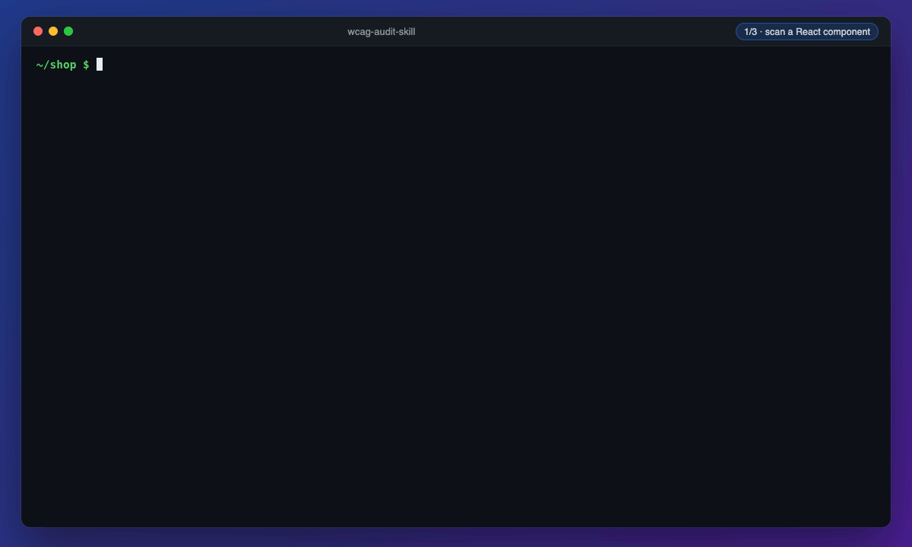

# wcag-audit-skill v0.1.0

**AI ships inaccessible UIs. This makes your agent fix them.**

wcag-audit-skill is an Agent Skill plus a CLI that audits a UI against WCAG 2.2 in phases:
static source scan, real-browser scan, verification, fix, report. Every finding is tied to a
success criterion, carries evidence and a concrete fix, and is re-checked after the fix.



## Highlights

- **One tool for HTML, React (JSX/TSX), Vue, Svelte and Astro.** 24 static rules mapped to
  WCAG 2.2 criteria: labels, names, alt text, fake buttons, heading order, ARIA typos, zoom,
  captions and more.
- **A real browser when you have a URL.** axe-core WCAG A/AA rules in Chromium, Chrome or
  Edge, plus a keyboard pass that tabs through the page to find keyboard traps and invisible
  focus (pixel-verified). Results are re-run so transient nodes do not become findings.
- **Verified, not just reported.** The skill makes the agent try to disprove each finding
  (trace props and spreads, check the rendered DOM) before fixing it, and `verify` proves
  the fix: resolved, remaining, introduced.
- **Machine-readable.** JSON findings with stable IDs and SARIF 2.1.0 for GitHub code scanning.
- **Agent-agnostic.** Claude Code plugin, `npx skills add`, Codex/`AGENTS.md`, Cursor rules.
- **CI-ready.** `uses: mintwork/wcag-audit-skill@v0` runs the scan and uploads SARIF.

## Field-tested

Measured on 10 real codebases (React/Next, Vue, SvelteKit, Astro, plain-HTML extensions;
6,880 files) and 7 live pages, with findings hand-checked against the source or DOM:

- Static precision: **91%** true positives on a fresh 43-finding hand-reviewed sample,
  0 false positives (the rest debatable). The pre-release version scored 70% with 15% clear
  false positives on a 315-finding sample.
- Speed: about 3,300 files/s.
- Robustness: 0 crashes on 6,880 files and 20,640 truncated-file fuzz runs; SARIF validates
  against the OASIS 2.1.0 schema.
- Runtime: same violations as raw axe-core on every page; 0 keyboard-trap false alarms.

## Install

```bash
# Claude Code
/plugin marketplace add mintwork/wcag-audit-skill
/plugin install wcag-audit@wcag-audit-skill

# Any skills-compatible agent
npx skills add https://github.com/mintwork/wcag-audit-skill --skill wcag-audit

# CLI
npx wcag-audit-skill scan ./src
npx wcag-audit-skill scan http://localhost:3000
```

```yaml
# GitHub Actions
- uses: mintwork/wcag-audit-skill@v0
  with:
    targets: src
    fail-on: serious
```

Requirements: Node.js 20+. Static scans need nothing else. Runtime scans use Playwright's
Chromium if installed (`npx playwright-core install chromium`), otherwise a local Chrome or Edge.

## Honest limits

Automated checks find roughly 30 to 50% of WCAG failures. This release cannot certify
conformance. Reports list what still needs a person: a screen-reader pass, zoom and reflow,
caption accuracy, cognitive review. Known gaps: `.mdx` files are not scanned, and labels that
come from component props defined in another file are only visible to the runtime scan.

## What's next

MDX and cross-file label resolution, more rules (`autocomplete-valid`, `label-in-name`,
table headers, duplicate ids), CSS focus-style analysis, multi-state runtime scans,
a CI baseline file, and `--fix` for mechanical rules. See the roadmap in the README.

Full list of changes: [CHANGELOG.md](../CHANGELOG.md).
